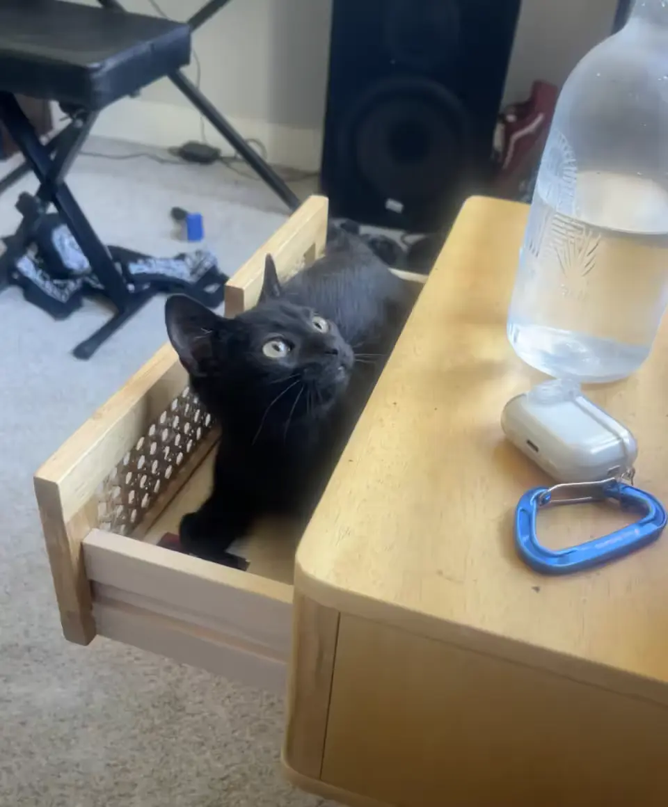
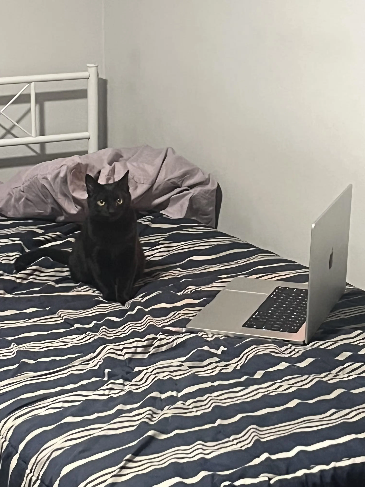
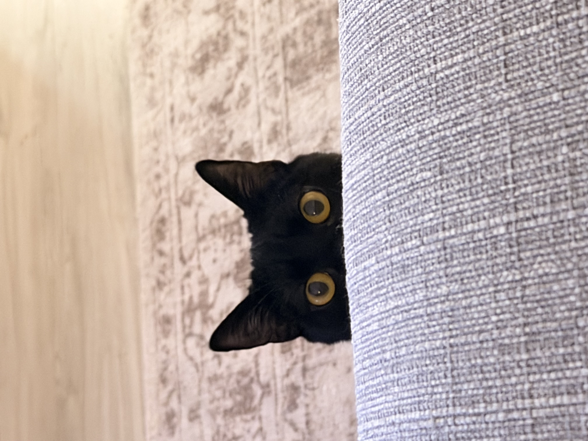
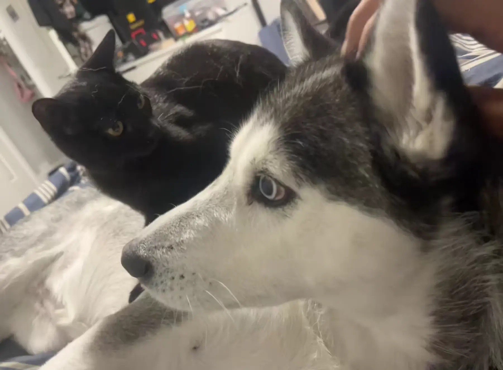
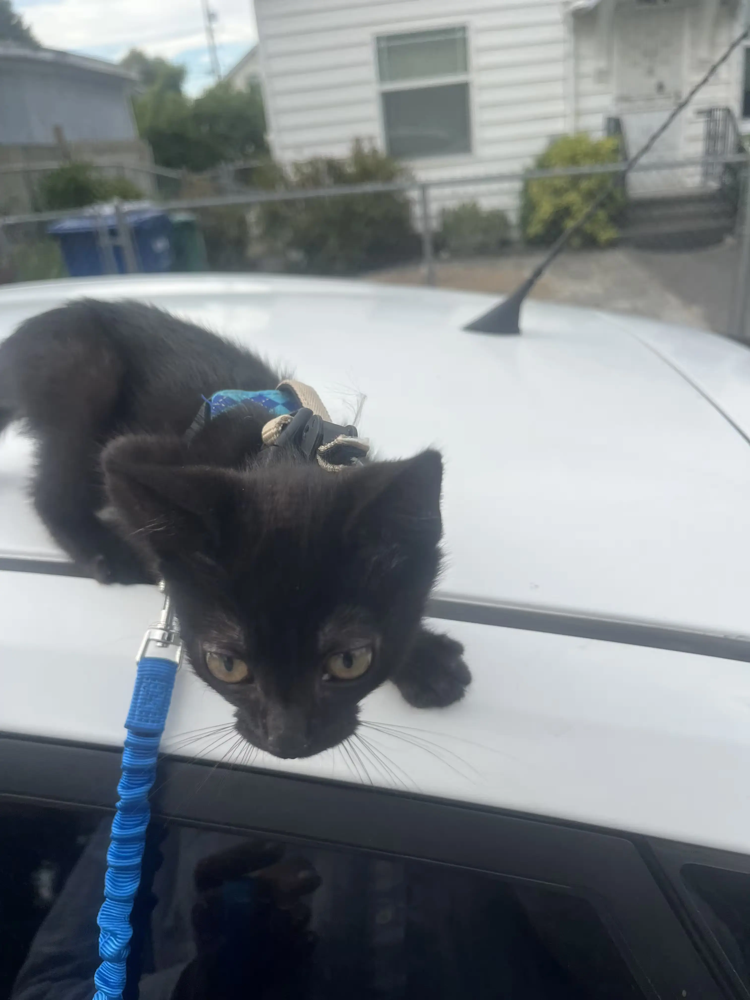

# Cat Sitting

{width="400"}

- Name: Kajal (American name: Bean)
- Born: May 22nd, 2025
- Breed: Domestic Short Hair Black Cat
- Gender: Female
- Spayed, so won't be having kids :(
- No medications
- No pet insurance, overpriced/unnecessary

## Costs

I generally don't pay the cat/dog sitters. I do have enough but also like saving some money :). Related, feel free to spoil her with treats/toys/etc, and I'd happily reimburse you! 

A gold chain might be too much to buy... but it would look cute so...

## Emergency/Vet

- Haven't needed to go to vet, but will do if needed. 
- I have a couple petco free vet vouchers that you can use
    - if not in bag, i can send you a picture and help you book appointment
- Emergency Contact: Kristie: (817) 673-9529, lives in beacon hill

{width="400"}

## Grooming

- I don't wash/groom her
- Cat's lick themselves clean all the time so 
- I accidentally turned on shower when she was in tub, so she scared of water
    - she also jumpy at loud noises

## Time Alone

- You can leave her alone for hours or days, doesn't matter
- I got her to keep company for Kiran when I leave the house :)
    - and it worked so you can leave Kiran at home for hours! 
    - like 12+ hours and she'll be super entertained so no worrying!

## Play

- Kiran and Kajal play all the time, no need to worry about them hurting one another
- Kiran may bark a little, but its all fun
- You can pet the cat, she will purr
    - Try not to let her bit too hard, but she does a playful bite when you rub her belly
    - Generally she bites my toes too hard when i move them around too much in bed
- Don't worry about knives or sharp objects, kajal is quick and smart to not get hurt
- She likes playing with trash-type materials
    - like if i open up new boxes, she likes playing with the plastic/cardboard
- She enjoys playing with string stuff a lot
- People have told me she is the most active cat they've ever met ("dog energy"), but I really don't see it. 

{width="400"}

## Hiding

- When I stop paying attention, Kajal likes just being in tight places
    - like under the bed or couch
- So you might think she has run away, but she is probably just in those areas
- Call her name and make some noise to get her to come out
    - I call kajal and kiran comes by
    - Kiran knows you are saying kajal but she just wants the attention too..
- I sometimes open and close cabinets/closets
    - she will sneak into these immediately when you open them
    - just try to get her out before you close them
    - I often leave her in the closet for hours and she is fine (by accident)

## Travel

- Feel free to take her out in the harness
- If loud noises she will try to climb onto your shoulders
    - her claws will be out too so might make some marks :(
- I actually really using the sling
- In the car, I just let her free, no leash/harness
    - However, she has peed on 2 friends that didn't know her in the car
    - Unsure why, she was out for awhile so maybe that was it?

{width="400"}

## Litter

She does scatch the wall after poopin, but who doesn't? So try to put something to protect wall if you can like cardboard or something.

- Really does smell
    - you need to find a good place to keep so you cant smell it
    - just test different locations around the house, you will find one!
    - if I remember to give you, I have dryer type sheets and litter spray to put in litter for smell
- Traditionally, you need clean the litter box daily
    - but kajal doesn't care and you can do it whenever
- I just use cheapest clay/sand litter
- She will know where the litter is when you put sand in it
- She rarely ever throws up (twice in 4 months)
    - And I've only seen a hairball in her lifespan
- And she has never pooped or peed outside the litterbox!

Someday I plan to teach her to poop and pee in toilet!

## Food

- I now just use the Costco generic cat food
    - I used Iams Chicken Kitten food - [purple bag](https://www.amazon.com/Iams-Proactive-Health-Healthy-Chicken/dp/B01BMBYKUQ?)
    - available at petco and qfc
    - I would recommend the generic adult Iams now that she is older than 1 year tho
- I leave unlimited cat food
    - there is this idea that intermediate fasting for animals extends lifespan (as does in humans)
    - I might plan to do this someday
- Kiran will not eat the cat food, so you can have both on the ground

## Water/Wet food

- I know that it is recommended for cats to have wet food...
    - but kajal drinks enough water cause she drinks when kiran eats food
- She will drink out of kiran's water bowl, so no need for separate bowls of water
- Leave water out at all times

## Treats

- I don't give her treats
    - but wouldn't hurt if you did
- Feel free to buy some and treat her! 
    - I'll pay you back
- Unsure what she likes the best
    - seems she likes the goyogurt type tubes, but kinda annoying to feed that to her

## Outside

- I take her out to events if all doors are closed
- And take her outside with a harness and leash
    - but don't walk her, just the harness and leash on if sitting in grass together
- but you don't need to do any of this
- She is scared of loud/big trucks so she will try to go on your shoulder when they pass

{width="400"}

## Tricks and Commands

- She is a loud purrer
- When she does her Meow, usually means she is in distress
    - might be because she is being held and wants to get down generally
- She kinda knows her name Kajal    
    - try to call her with her name kajal to get her to know it
- I sometimes play a quick highfive game with her
- I lift her up like simba all the time
- She can play all day, so feel free to play all day!

## Nail Cutting

- I cut her nails a few times when I first got her
- But i rarely do
- If the nailcutter is in the bag, feel free to try to cut her nails
    - she might try to escape when you do but doesn't take that long and can do 1 at a time
- she generally only takes out her nails when she is on your shoulder and gets scared
- otherwise will not take out her nails when you pick her up

## Scratching

- She likes climbing
- She especially likes climbing the windows screens over glass
    - I let her do this, she has never ripped my window screens so why not?
    - Prasana said to stop this behavior cause screen will fall if heavier
        - will teach to stop
- I have a couple cardboard scratch pads, hopefully i brought you one!
- She hangs on my window seal on the 7th floor without a screen and has never jumped
    - however, she has jumped into yard of a house through window, so be careful

{width="400"}

## Sleep

- She sleeps near my legs on my bed with me
- Seems this is not the case with everyone
- She generally finds a chair or place in couch to sleep for awhile
    - she doesn't really mind if you wake her up, low cortisol cat

## Cat Safety

- She will knock over things off counters
    - or like plants in plastic containers she drops off counters
        - if they are in ceramic they won't fall
        - she doesn't do it on purpose i think? but maybe she does

Actually she doesn't really do this at all anymore!!!!  

