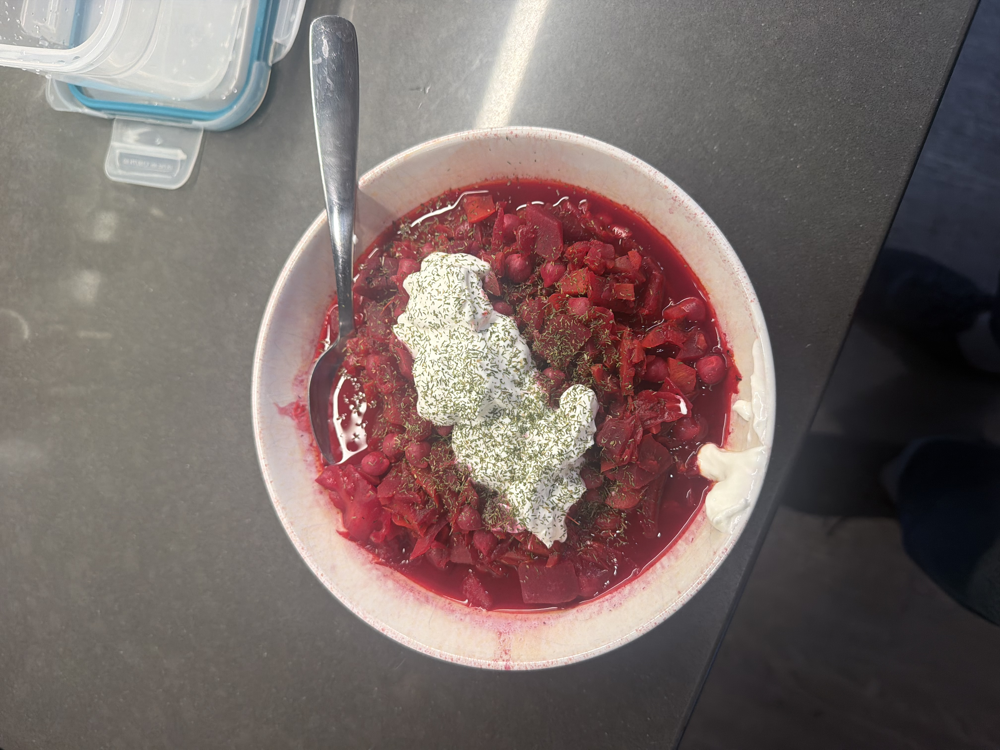

# Borscht

I made this to impress Lydia's sisters. I however I made a huge quantity (like I normally do lol)! It turned out super good!

- [Borscht Vegan YTB Short](https://www.youtube.com/shorts/iN0XGb_bYRc)
- [Borscht Meat YTB Short](https://www.youtube.com/shorts/EKro98s2qhA)

## Ingredients:

Fry these in oil:

- Shallots
- Onions

Then chop/finely slice/or grate:

- NOTE: No need to peel!
- Add Carrots
- Add Beets
- Add Water
- Add Cabbage
- Protein! (I had soaked chickpeas, so added that)
    - lots of ytb vids have big bone-in meats!

Spices

- bay leaf
- vinegar (for some kick)
- black pepper (for more kick)
- garlic (for some reason said to add later)
- broth or concentrate broth (enough salt to not add more)

